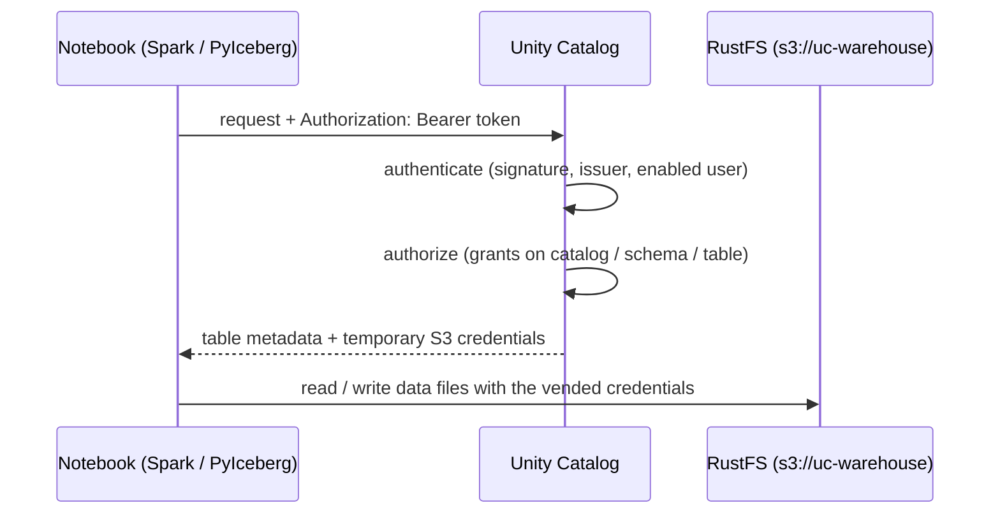

# Authentication and access control

The bundled Unity Catalog (`uc=local`) starts **open**: no tokens, and every
request is allowed. That's the fastest way to try the notebooks, but it hides
the part of Unity Catalog that matters most in a real lakehouse, which is
deciding who can read and write which data. This guide explains why you'd turn
authentication on, how it works in the playground, and what each `just` recipe
is for.

For a hands-on walkthrough (personas, a denied request, a live grant), see
[getting-started.md](getting-started.md).

## Why turn it on

### With auth off, anyone who can reach UC can do anything

With `server.authorization=disable`, UC approves every request without asking
who sent it. Anyone who can reach port 8080 can list, create, and drop catalogs,
schemas, and tables. They can also ask UC for **temporary S3 credentials** for
any table.

That last point is the important one. In a lakehouse the catalog is the
gatekeeper to storage: Spark, PyIceberg, and other engines don't hold long-lived
bucket keys; they ask UC for short-lived credentials scoped to the table they
are opening. If UC hands those out to anyone, the bucket is effectively open
too.

### With auth on, every request answers two questions

1. **Authentication: who are you?** The request must carry a bearer token that
   UC can verify, for a user that exists and is enabled in UC.
2. **Authorization: are you allowed to do this?** UC checks the user's grants
   (privileges) on the catalog, schema, and table involved.

Credential vending follows the same rules. To get read credentials for a table,
a user needs `USE CATALOG` on its catalog, `USE SCHEMA` on its schema, and
`SELECT` on the table (or ownership). Write credentials need `SELECT` and
`MODIFY`, or ownership.



### Why practice it locally

Code that works against an open catalog often fails against a governed one: a
job that creates a table now needs `CREATE TABLE` on the schema, a dashboard
user needs `SELECT`, and tables suddenly have owners. Running the playground
with auth on, as users with different privileges, lets you find missing grants
and 403s on your laptop rather than in production. The same model applies to a
managed Unity Catalog and to UC OSS behind a real identity provider.

## How it works in the playground

**The server switch.** UC reads `server.authorization` from
`server.properties`, and only at startup. In this repo that file is a template
(`etc/conf/server.properties`) rendered into the `uc_conf` Docker volume by the
`rustfs-init` service on every `up`. The playground keeps the mode in `.env` as
`UC_AUTHORIZATION=enable|disable`; `rustfs-init` writes it into
`server.properties`, and the auth recipes restart UC so it takes effect.

**Tokens.** UC issues its own JWTs: issuer `internal`, signed RS512 with a
private key UC generates on first start and keeps in the `uc_conf` volume
(`private_key.der`, `key_id.txt`). A request is authenticated when its token is
signed by that key and the token's subject (`sub`) is an **enabled** user in
UC's user table.

**Where tokens come from.** In production, users sign in with an identity
provider (Google, Okta, Entra ID, ...) and exchange that provider's token at
`POST /auth/tokens` for a UC token. That exchange is where
`server.allowed-issuers` and `server.audiences` apply. The playground has no
identity provider, so `just uc=local token-for <email>` signs the token directly
with the server's key. UC can't tell the difference: it's the same token the
exchange would have returned.

**The admin.** On every start UC writes `token.txt`, a service token for the
built-in `admin` user with no expiry. The first time UC starts with auth
enabled, it creates `admin` and makes it the metastore **owner**, the one
identity that can do everything.

**Grants.** Privileges are stored in Postgres (the `casbin_rule` table) and
follow the catalog → schema → table hierarchy, so a grant on a schema also
covers tables created in it later.

## The recipes

All of these are for the bundled UC, so run them with `uc=local`. The token and
grant recipes read the signing key or admin token from the running
`unitycatalog` container and need `jq`, `openssl`, `curl`, and `uuidgen` on your
PATH.

### `just uc=local auth=enable set-auth` (or `auth=disable`)

Turns auth on or off without rebuilding anything. It saves `UC_AUTHORIZATION`
to `.env`, re-renders the UC config, restarts UC, and waits until UC answers.
If the stack is stopped, it only saves the setting, and the next
`just uc=local up` uses it.

**Why it matters:** UC only reads its config at startup, and `rustfs-init`
rewrites that config on every `up`. Editing `server.properties` by hand doesn't
stick; saving the mode to `.env` keeps it the same across `up`, `restart`, and
`rotate-creds`.

### `just uc=local demo-noauth` and `just uc=local demo-auth`

One-command starts for each mode. Both build the images, save the mode, start
(or restart) the stack, and print the marimo URLs. `demo-auth` also runs
`bootstrap-users` and prints the admin token.

**Why it matters:** each mode needs a few steps in the right order (save the
mode, restart UC, wait for it, seed users). These recipes do them in order, and
they also work when switching an already-running stack between modes.

### `just uc=local token`

Prints the admin token: the built-in `admin` user, metastore owner, no expiry.

**Why it matters:** it's the bootstrap key. Creating users and granting
privileges needs it, and `bootstrap-users` and `grant` use it for you. Treat it
like a root password: it bypasses every grant, so it's the wrong token for
checking whether your code works for an ordinary user.

### `just uc=local token-for <email>`

Mints a token for a UC user, signed with the server's key. Tokens last 30 days;
set `EXP_DAYS` to change that (for example `EXP_DAYS=1 just uc=local token-for
lisa@uc-demos.dev`). The token only authenticates once that user exists and is
enabled, and the recipe warns you if it doesn't.

**Why it matters:** testing as a least-privileged user is the point of turning
auth on. With this recipe you can act as any user without setting up an identity
provider.

### `just uc=local bootstrap-users`

Seeds five demo users and a grant layout on a new `demo` catalog. It's safe to
re-run; existing users and grants are left alone.

| User | Access |
| --- | --- |
| `power-user@uc-demos.dev` | Can create catalogs, credentials, and external locations; owns `demo` and `demo.workshop` |
| `scott@uc-demos.dev` | Author on `demo.workshop`: create tables, read, write |
| `jules@uc-demos.dev` | Read-write on `demo.workshop` |
| `lisa@uc-demos.dev` | Read-only on `demo.workshop` |
| `robert@uc-demos.dev` | No grants: every request to `demo` is denied until you grant him something |

**Why it matters:** these users cover the access levels you'll meet in practice,
so you can see the same query succeed for one user and get a 403 for another.
The `demo` catalog is created **with auth on**, so its ownership and grants are
recorded properly (see [Things to know](#things-to-know)).

### `just uc=local grant <grant|revoke> -t <type> -n <name> -p <principal> -P <privilege>`

Grants or revokes one privilege, running as the admin token. Privileges can be
written with underscores (`USE_CATALOG`) to avoid shell quoting.
`just uc=local grant --help` lists the securable types and privileges.

```bash
just uc=local grant grant  -t catalog -n demo          -p robert@uc-demos.dev -P USE_CATALOG
just uc=local grant grant  -t schema  -n demo.workshop -p robert@uc-demos.dev -P USE_SCHEMA
just uc=local grant grant  -t schema  -n demo.workshop -p robert@uc-demos.dev -P SELECT
just uc=local grant revoke -t schema  -n demo.workshop -p robert@uc-demos.dev -P SELECT
```

**Why it matters:** access control is something you change while the system is
running. Grants and revokes take effect right away, with no restart, so you can
watch a 403 turn into a successful read and back again.

## Using a token from the notebooks

The notebooks read the token from `UC_TOKEN`:

- **For the whole stack:** put a token in `.env` as `UC_TOKEN=...` and run
  `just uc=local restart`. Both marimo containers pick it up, including the
  Iceberg notebooks and their UC REST calls.
- **For one Spark session:** pass it to `common.initialize`:

  ```python
  import common
  spark = common.initialize(catalog="demo", token="<token from just uc=local token-for ...>")
  ```

Spark builds each catalog's client once per session and reuses it. Calling
`common.initialize` again with a different user's token for the same catalog
keeps the first token. To switch users, restart the marimo kernel and run the
cell with the new token.

## Things to know

- **Objects created with auth off have no owner.** While auth is disabled, UC
  records neither owners nor the catalog → schema → table links. Those objects
  don't inherit anything later, so even the admin needs explicit grants on them
  once auth is on. Prefer the `demo` catalog that `bootstrap-users` creates, or
  recreate older objects with auth enabled.
- **Wiping volumes resets identity.** The signing key lives in the `uc_conf`
  volume and the users and grants in `uc_postgres_data`. `just down` and
  `just restart` keep both. `just down-volumes` and `just clean` delete them, so
  every existing token stops working; run `just uc=local demo-auth` again to
  re-seed.
- **Tokens are bearer secrets.** Whoever holds one acts as that user. `.env` is
  git-ignored, but notebooks are committed `.py` files, so don't leave a pasted
  token in a notebook cell.
- **The signing key is the real trust boundary.** Anyone who can read the
  `uc_conf` volume, which means anyone with Docker access on this machine, can
  mint a token for any user. That's fine for a local playground. Don't expose
  this stack beyond your machine, and change the default RustFS credentials
  (`rustfsadmin`) if you ever do.
- **Restart Spark after switching modes.** A Spark session started without a
  token fails every catalog call once auth is on. Restart the kernel and pass a
  token.

## Troubleshooting

- **401 Unauthorized:** the request had no token. Get one with
  `just uc=local token` or `just uc=local token-for <email>`.
- **Token rejected after `just clean` or `just down-volumes`:** the signing key
  was regenerated, so older tokens no longer verify. Mint fresh ones.
- **403 / `PERMISSION_DENIED`:** UC knows who you are, but you lack a privilege.
  Reading a table needs `USE CATALOG` + `USE SCHEMA` + `SELECT`. Grant what's
  missing with `just uc=local grant ...`.
- **`User not allowed: <email>`:** the token is valid but the user doesn't exist
  or is disabled. Run `just uc=local bootstrap-users`, or create the user first.
- **A Spark write without `MODIFY` hangs:** in testing, an `INSERT` into a
  catalog-managed Delta table by a read-only user (`lisa`) didn't fail; it was
  still waiting after three minutes. Reads by the same user work. Interrupt the
  cell (or restart the kernel) and grant `MODIFY` if the write is intended.

## Further reading

- [getting-started.md](getting-started.md): step-by-step walkthrough of both modes.
- [Unity Catalog authentication docs](https://github.com/unitycatalog/unitycatalog/blob/v0.7.0/docs/server/auth.md):
  identity providers, token exchange, and `allowed-issuers` / `audiences`.
- [AGENTS.md](../../AGENTS.md): how the RustFS credential vending and `uc_conf`
  rendering work.
