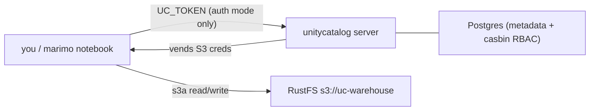

# Getting started

This playground runs a self-contained Unity Catalog (UC) lakehouse locally:
marimo + Spark talking to a bundled UC server whose managed-table data lives in
[RustFS](https://rustfs.com/) (an S3-compatible object store). It runs in **two
modes**, and this guide walks through both:

- **No auth** — the open quickstart. No tokens, anyone can do anything. Fastest
  way to kick the tires.
- **Auth** — `server.authorization=enable`. Every request needs a bearer token,
  and access is governed by Unity Catalog's role-based access control (RBAC).
  This mode also seeds five demo **personas** so you can *feel* how permissions
  work.

For why auth matters and what each auth recipe does, see
[authentication.md](authentication.md). For the deeper "why" behind the rest of
the stack (RustFS credential vending, Postgres metadata, proxies), see
[AGENTS.md](../../AGENTS.md). This guide is the fast path.



## Prerequisites

Docker (with Compose), [`just`](https://github.com/casey/just), and — for token
minting in auth mode — `jq`, `openssl`, and `curl` on your PATH (all standard on
macOS/Linux). See [AGENTS.md](../../AGENTS.md) for corporate-proxy setup
(`MAVEN_PROXY_URL` / `PYPI_PROXY_URL`).

All commands below use `uc=local` (the bundled UC). The `auth` mode is selected
by the recipe or the `auth=enable|disable` variable.

---

## Mode 1: No auth (quickstart)

```bash
just uc=local demo-noauth
```

This builds the image, starts the stack with `server.authorization=disable`, and
prints the marimo URL. Open it and run a notebook — no token required.

Verify it is open (no token needed):

```bash
curl -s -o /dev/null -w '%{http_code}\n' \
  http://localhost:8080/api/2.1/unity-catalog/catalogs      # -> 200
```

Tear down / switch later with `just uc=local down` (keeps data) or flip auth on
in place with `just uc=local auth=enable set-auth`.

---

## Mode 2: Auth + personas

```bash
just uc=local demo-auth
```

This builds, starts the stack with `server.authorization=enable`, waits for UC,
then **bootstraps the demo personas** and prints the admin token + marimo URL.

Confirm auth is enforced:

```bash
curl -s -o /dev/null -w '%{http_code}\n' \
  http://localhost:8080/api/2.1/unity-catalog/catalogs      # -> 401 (no token)
```

### The identities

| Principal | How it authenticates | Role |
| --- | --- | --- |
| `admin` (built-in) | `just uc=local token` (self-signed at startup) | **Metastore OWNER** — the superuser used for bootstrapping |
| `power-user@uc-demos.dev` | `just uc=local token-for power-user@uc-demos.dev` | Delegated admin: can create catalogs/credentials/locations; **owns** catalog `demo` + schema `demo.workshop` |
| `scott@uc-demos.dev` | `just uc=local token-for scott@uc-demos.dev` | **Author** on `demo.workshop` (USE, CREATE TABLE, SELECT, MODIFY) |
| `jules@uc-demos.dev` | `just uc=local token-for jules@uc-demos.dev` | **Read-write** on `demo.workshop` (USE, SELECT, MODIFY) |
| `lisa@uc-demos.dev` | `just uc=local token-for lisa@uc-demos.dev` | **Read-only** on `demo.workshop` (USE, SELECT) |
| `robert@uc-demos.dev` | `just uc=local token-for robert@uc-demos.dev` | **No grants** — used to demonstrate a 403 and live grants |

Notes:

- Unity Catalog OSS (through 0.7) has no API to grant true metastore `OWNER` to an
  arbitrary email, so the built-in `admin` (the `token.txt` identity) stays the
  real owner. `power-user` is a *delegated* admin via metastore-level grants.
- There is no external identity provider here. `just token-for <email>` mints a
  UC-internal RS512 JWT locally, signed with the server's own key — UC accepts it
  exactly like an OIDC-exchanged token. It only works for a user that exists and
  is enabled (that's what `bootstrap-users` sets up).

### Re-running the bootstrap

`just uc=local bootstrap-users` is idempotent — safe to re-run (existing users
and grants are left in place).

---

## Using a persona in the notebook

The notebook helper reads a bearer token and wires it into Spark. Two ways to
use one:

**A. Per session.** In a marimo cell:

```python
import common
# paste a token from `just uc=local token-for lisa@uc-demos.dev`
spark = common.initialize(catalog="demo", token="<paste-token>")
spark.sql("SELECT * FROM demo.workshop.pets").show()   # lisa can read
```

Spark builds each catalog's client once per session, so calling
`common.initialize` again with another persona's token for `demo` keeps the
first token. To switch personas, restart the marimo kernel and run the cell
with the new token.

**B. Via `UC_TOKEN` env (whole session).** Put a token in `.env` as
`UC_TOKEN=...` then `just uc=local restart`. The notebook picks it up
automatically (`common.initialize(catalog="demo")`).

To get the admin token for `UC_TOKEN`, use `just uc=local token`.

---

## Permissions walkthrough

This is the fun part — watch RBAC in action.

### 1. Read as `lisa` (allowed), write as `lisa` (denied)

Mint lisa's token and use it in a notebook cell against `demo.workshop`. A
`SELECT` succeeds; an `INSERT`/`UPDATE` is denied — lisa has `SELECT` but not
`MODIFY`. From Spark, the denied write currently hangs instead of raising an
error, so interrupt the cell (see
[authentication.md](authentication.md#troubleshooting)).

### 2. `robert` is denied, then granted live

Robert starts with no grants, so any access to `demo` returns
`PERMISSION_DENIED` (403). Grant him read access and watch it start working:

```bash
# read-only for robert on the whole workshop schema (inherits to its tables)
just uc=local grant grant -t catalog -n demo             -p robert@uc-demos.dev -P USE_CATALOG
just uc=local grant grant -t schema  -n demo.workshop    -p robert@uc-demos.dev -P USE_SCHEMA
just uc=local grant grant -t schema  -n demo.workshop    -p robert@uc-demos.dev -P SELECT
```

Re-mint robert's token (or reuse it) and the same `SELECT` now succeeds. Revoke
just as easily:

```bash
just uc=local grant revoke -t schema -n demo.workshop -p robert@uc-demos.dev -P SELECT
```

Privileges accept spaces or underscores (`USE CATALOG` == `USE_CATALOG`). Run
`just uc=local grant --help` for the full list of securable types and
privileges.

### 3. `scott` (author) creates a table on RustFS end-to-end

Mint scott's token and, in a notebook cell:

```python
import common
spark = common.initialize(catalog="demo", token="<scott-token>")
spark.sql("CREATE TABLE IF NOT EXISTS demo.workshop.pets (id INT, name STRING) USING DELTA")
spark.sql("INSERT INTO demo.workshop.pets VALUES (1, 'ada'), (2, 'linus')")
spark.sql("SELECT * FROM demo.workshop.pets ORDER BY id").show()
```

The write lands in RustFS under `s3://uc-warehouse/__unitystorage/tables/...`.
Because lisa/jules were granted `SELECT`/`MODIFY` at the schema level, they can
immediately read (and, for jules, write) this brand-new table — the grants
inherit down the catalog -> schema -> table hierarchy.

---

## Switching modes and teardown

- Flip auth without a rebuild: `just uc=local auth=disable set-auth` (or
  `auth=enable`). This re-renders the UC config and restarts the server.
- `just uc=local down` — stop containers, keep all data (Postgres metadata,
  RustFS data, and the `uc_conf` volume that holds the JWT signing keys).
- `just uc=local down-volumes` / `just uc=local clean` — wipe everything.

**Key-persistence caveat (auth mode):** the JWT signing keys and admin
`token.txt` live in the `uc_conf` volume and survive `down`/`restart`, so tokens
keep working. `down-volumes`/`clean` regenerate the keys — after that, re-fetch
the admin token (`just uc=local token`), re-run `just uc=local bootstrap-users`,
and re-mint persona tokens.

---

## Troubleshooting

- **401 Unauthorized** — no/blank token in auth mode. Fetch one:
  `just uc=local token` (admin) or `just uc=local token-for <email>` (persona).
- **403 PERMISSION_DENIED** — authenticated but not authorized. The principal
  lacks the needed privilege (e.g. `USE CATALOG` + `USE SCHEMA` + `SELECT`).
  Grant it with `just uc=local grant ...`. Note: objects created earlier under
  *no-auth* have `owner: null`, so even the metastore admin needs explicit grants
  on them — prefer the `demo` catalog created by the bootstrap.
- **`This Unity Catalog endpoint is disabled for MANAGED Delta tables ...`** —
  expected; managed tables use the Delta REST API path (what Spark uses
  automatically). Nothing to do.
- **`403 Forbidden` / `AccessDeniedException` on `s3://uc-warehouse/...`** — the
  RustFS STS credential UC vends has expired. Refresh with
  `just uc=local rotate-creds`, then restart the Spark session. See
  [AGENTS.md](../../AGENTS.md) for details.
- **Port 9000/9001 already allocated** — another local stack is using RustFS's
  ports. Start with different host ports, e.g.
  `RUSTFS_API_PORT=9010 RUSTFS_CONSOLE_PORT=9011 just uc=local demo-auth`
  (the in-network `rustfs:9000` endpoint is unaffected).
